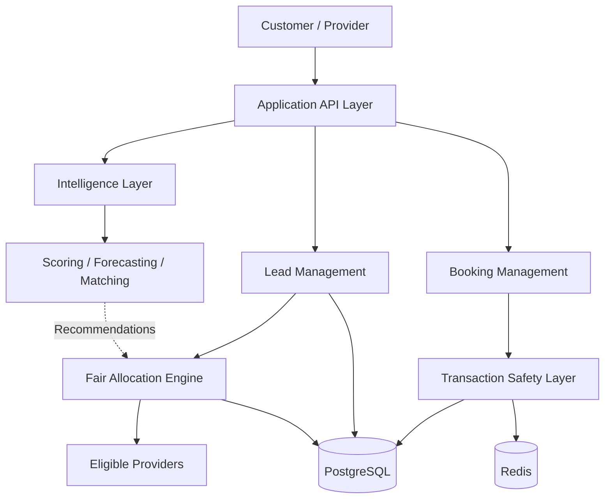
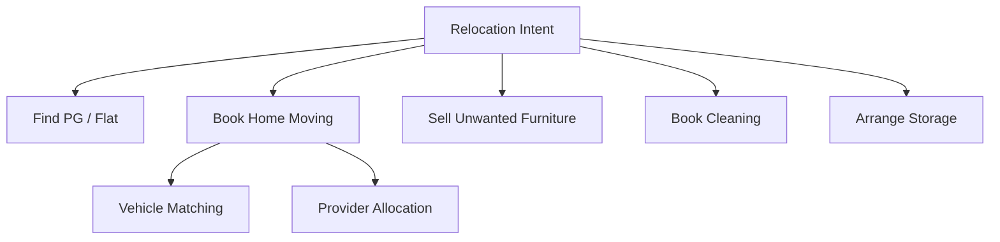

# 4mulaShift

### A Fair, Reliable & Unified Relocation Ecosystem

**4mulaShift** is a relocation and logistics platform designed to unify moving, accommodation discovery, marketplace transactions, and essential relocation services through a common, fairness-driven backend engine.

The project focuses on solving structural problems in relocation workflows—unfair vendor allocation, booking race conditions, duplicate payment requests, inefficient vehicle selection, and fragmented service coordination—through deterministic algorithms, transaction-safe systems, and modular architecture.

> **One relocation ecosystem. One allocation engine. Reliable transactions by design.**

---

## Table of Contents

- [Overview](#overview)
- [The Problem](#the-problem)
- [Our Approach](#our-approach)
- [Core Engineering Principles](#core-engineering-principles)
- [Core Platform Capabilities](#core-platform-capabilities)
- [Fair Allocation Engine](#fair-allocation-engine)
- [Vehicle Matching System](#vehicle-matching-system)
- [System Architecture](#system-architecture)
- [Technology Stack](#technology-stack)
- [Relocation Intent Graph](#relocation-intent-graph)
- [Development Roadmap](#development-roadmap)
- [Engineering Challenges](#engineering-challenges)
- [Project Status](#project-status)
- [Future Scope](#future-scope)
- [Contributing](#contributing)
- [License](#license)

---

## Overview

Relocation is not a single transaction. It is a chain of interconnected requirements.

A person moving to a new city may need to find accommodation, hire movers, sell unwanted furniture, arrange storage, book cleaning services, and manage several providers—all while coordinating timelines, availability, and payments.

4mulaShift aims to bring these disconnected activities into a unified relocation ecosystem.

At its core, the platform is designed around a backend engine that converts user intents into structured leads, applies configurable allocation logic, manages resource availability, and coordinates transaction-safe workflows.

### The Core Idea

Instead of treating every service as an isolated application, 4mulaShift treats relocation as a connected lifecycle.

- Fair provider allocation instead of uncontrolled lead distribution.
- Transaction-safe bookings instead of check-then-book race conditions.
- Idempotent operations instead of duplicate processing on retries.
- Capacity-aware vehicle selection instead of guesswork.
- Unified lead management instead of disconnected service workflows.

---

## The Problem

Relocation services are fragmented across multiple platforms and traditional intermediaries, creating inefficiencies for both customers and service providers.

| Problem | Impact |
|---|---|
| Broker spam | Excessive calls and poor customer experience |
| Vendor concentration | Smaller service providers struggle to receive opportunities |
| Double booking | Conflicting reservations and unreliable availability |
| Duplicate payment requests | Financial inconsistencies during retries |
| Incorrect vehicle selection | Unnecessary costs or inadequate capacity |
| Fragmented services | Multiple platforms to complete a single relocation |
| Lack of transparency | Limited visibility into how vendors are selected |

---

## Our Approach

4mulaShift is designed to address these problems through a common backend architecture.

| Challenge | Proposed solution |
|---|---|
| Unfair lead distribution | Configurable fairness-based allocation engine |
| Vendor monopoly | Quota-aware distribution |
| Booking conflicts | Database-level concurrency control |
| Duplicate requests | Idempotency mechanisms |
| Vehicle mismatch | Volume and weight-based vehicle selection |
| Service fragmentation | Unified relocation intent and lead management |
| Operational opacity | Allocation records and fairness metrics |

---

## Core Engineering Principles

### Fairness by Design
Provider allocation considers eligibility, workload, inactivity, quality, and operational performance rather than relying solely on first-response or paid-priority models.

### Safety Before Intelligence
Critical operations such as booking confirmation, resource locking, and payment state management rely on deterministic and verifiable mechanisms.

### Idempotent Operations
Repeated requests caused by retries or network failures should not result in duplicate transactions.

### Transactional Integrity
Critical state changes should remain consistent under concurrent requests and failures.

### Modular Architecture
The platform begins with a modular architecture, keeping domains separated without introducing unnecessary distributed complexity.

### AI-Assisted, Not AI-Dependent
Machine learning can improve predictions and recommendations, but safety-critical operations should retain reliable rule-based fallbacks.

---

## Core Platform Capabilities

### 1. Fair Vendor Allocation

A configurable allocation engine selects eligible providers and ranks them based on operational fairness and performance signals.

Potential scoring factors include:

- Time since last completed order
- Remaining monthly allocation quota
- Provider rating
- Cancellation history
- Distance or service coverage
- Availability and service capacity

The objective is to distribute opportunities fairly while maintaining service quality.

### 2. Concurrency-Safe Booking

Booking workflows are designed to protect shared resources against simultaneous reservation attempts.

The design uses concepts such as:

- Database transactions
- Pessimistic row locking
- Resource availability validation
- Atomic state transitions
- Conflict handling

The objective is to prevent two competing transactions from successfully reserving the same exclusive resource.

### 3. Idempotency & Payment Reliability

Critical requests may be retried because of timeouts, unstable connectivity, or client-side failures.

The platform is designed to use idempotency keys to recognize repeated operations and avoid duplicate processing.

Idempotency is intended to cover booking operations and payment-related workflows, with appropriate persistent state and failure handling.

### 4. Volumetric Vehicle Matching

Moving requirements can be translated into estimated volume and weight to determine suitable vehicle categories.

The initial approach is rule-based, with future potential for image-assisted estimation.

### 5. Integrated Marketplace

Users may be able to sell, purchase, donate, or arrange disposal of unwanted relocation items through an integrated marketplace.

Marketplace workflows can be connected to relocation services to reduce logistical friction.

### 6. Unified Lead Management

Different types of customer intent can share a common lead lifecycle and allocation infrastructure.

| Lead Type | Matching Strategy |
|---|---|
| Home moving | Provider eligibility and fairness scoring |
| PG accommodation | Availability, location, and suitability |
| Flat rental | Location and property requirements |
| Marketplace purchase | Product/category matching |
| Marketplace sale | Buyer and category matching |
| Cleaning services | Service coverage and availability |
| Painting services | Skill, location, and availability |
| Storage | Capacity and location matching |

---

## Fair Allocation Engine

The allocation engine is one of the core engineering components of 4mulaShift.

Rather than distributing leads solely based on response speed or listing priority, the platform explores a scoring-based model that considers provider opportunity, quality, and operational behavior.

### Proposed Allocation Score

A configurable scoring model may use:

\[
\begin{aligned}
Score ={} & (D \times 10) \\
& + (Q \times 5) \\
& + (R \times 2) \\
& - (C \times 20) \\
& - P_d
\end{aligned}
\]

Where:

| Variable | Meaning |
|---|---|
| \(D\) | Days since the provider's last order |
| \(Q\) | Remaining monthly allocation quota |
| \(R\) | Provider rating |
| \(C\) | Cancellation count |
| \(P_d\) | Distance penalty |

The weights are initial design parameters, not fixed constants. They require validation, calibration, and fairness testing.

### Allocation Workflow

1. Identify providers eligible for the requested service.
2. Filter by city, availability, capacity, and requirements.
3. Calculate the allocation score.
4. Rank eligible providers.
5. Select a limited shortlist of providers.
6. Create allocation records.
7. Track offers, acceptance, rejection, expiration, and completion.
8. Evaluate fairness metrics over time.

The engine is intended to be reusable across multiple lead types through configurable eligibility rules and scoring strategies.

---

## Vehicle Matching System

Vehicle selection should be based on actual relocation requirements instead of vague household descriptions.

### Initial Rule-Based Model

| Vehicle Category | Illustrative Capacity |
|---|---:|
| Mini | 50 CFT |
| Tempo | 200 CFT |
| Truck | 800 CFT |

The platform can use estimated cargo volume and weight to recommend an appropriate category.

Future iterations may include:

- Item-based volume estimation
- Furniture catalog measurements
- Photo-assisted object detection
- Capacity optimization
- AI-generated vehicle recommendations

These capacity values are illustrative and subject to real-world vehicle specifications and validation.

---

## System Architecture

4mulaShift follows a planned two-lane architecture.

### Lane 1 — Safety & Transaction Engine

Responsible for critical business operations.

- Lead creation
- Provider allocation
- Booking
- Availability
- Database transactions
- Idempotency
- Payment state management

**Primary design principle:** deterministic, testable, and reliable behavior.

### Lane 2 — Intelligence & Optimization

Responsible for data-driven enhancements.

- Predictive vendor scoring
- Demand forecasting
- Dynamic pricing
- Fraud detection
- Image-based volume estimation
- Route optimization
- Intelligent recommendations

**Primary design principle:** AI improves decision quality without becoming a dependency for core transaction safety.

---

## Technology Stack

### Phase 1 — Core Backend

| Technology | Role |
|---|---|
| Java 21 | Core backend language |
| Spring Boot 3 | Application framework |
| PostgreSQL 16 | Transactional relational database |
| Redis 7 | Idempotency, caching, and coordination |
| Flyway | Database schema versioning |
| JUnit 5 | Unit and integration testing |
| Testcontainers | Infrastructure-backed testing |
| Docker | Containerized development and deployment |

### Planned Intelligence Stack

| Technology | Purpose |
|---|---|
| Python | ML and data processing |
| FastAPI | ML service API |
| Scikit-learn | Statistical and ML models |
| XGBoost | Predictive scoring |
| MLflow | Experiment tracking |
| ONNX Runtime | Model inference integration |

### Planned Streaming & Infrastructure

| Technology | Potential use |
|---|---|
| Kafka | Event streaming |
| Kafka Streams / Flink | Stream processing |
| Prometheus | Metrics |
| Grafana | Monitoring dashboards |
| OpenTelemetry | Distributed observability |
| Kubernetes | Orchestration at scale |

> The technologies above represent the planned stack across development phases. They are not all currently implemented.

---

## Relocation Intent Graph

A relocation journey can consist of several related user intents.

For example:

Instead of managing these as unrelated transactions, 4mulaShift aims to connect them through a shared relocation journey.

This creates opportunities for:

- Better service coordination
- Context-aware recommendations
- Reduced repeated data entry
- Connected booking workflows
- More relevant service discovery

---

## Development Roadmap

### Phase 1 — Core Relocation Engine

- [ ] Relocation request management
- [ ] Vendor onboarding and verification
- [ ] Eligibility and availability filtering
- [ ] Fair vendor allocation
- [ ] Booking lifecycle
- [ ] Concurrency protection
- [ ] Idempotency
- [ ] Vehicle capacity matching
- [ ] Integration and concurrency tests

### Phase 2 — Ecosystem Expansion

- [ ] PG / hostel discovery and booking
- [ ] Flat rental workflows
- [ ] Marketplace
- [ ] Donation integrations
- [ ] Demand forecasting
- [ ] Dynamic pricing research
- [ ] Vendor fairness dashboard

### Phase 3 — Intelligence & Automation

- [ ] AI-based volume estimation
- [ ] Fraud and anomaly detection
- [ ] Route optimization
- [ ] Damage claims workflows
- [ ] Live relocation tracking
- [ ] Insurance integrations
- [ ] Real-time event processing

### Phase 4 — Scale & Platformization

- [ ] Multi-city expansion
- [ ] Independent service scaling
- [ ] Partner integrations
- [ ] B2B relocation workflows
- [ ] White-label platform APIs
- [ ] Advanced observability
- [ ] Distributed infrastructure

---

## Engineering Challenges

4mulaShift is intended to explore practical backend and distributed systems challenges, including:

- Race conditions under concurrent booking requests
- Lock contention and transaction boundaries
- Idempotency key lifecycle and expiry
- Consistency between booking and payment states
- Fairness versus service quality in allocation
- Failure recovery during partially completed workflows
- Cache invalidation and data freshness
- Evolving a modular backend without premature microservices

---

## Project Status

4mulaShift is under active development and follows a phased approach.

The architecture, proposed capabilities, and roadmap describe the intended direction of the project. Feature availability may vary based on the current implementation.

| Area | Status |
|---|---|
| Core architecture | In development |
| Relocation lead engine | Planned / evolving |
| Fair allocation engine | Planned / evolving |
| Booking safety | Planned / evolving |
| Idempotency | Planned / evolving |
| Vehicle matching | Planned / evolving |
| Marketplace | Future scope |
| AI/ML capabilities | Future scope |

---

## Future Scope

4mulaShift is envisioned to expand beyond household relocation into a broader logistics and relocation ecosystem.

Potential future domains include:

- PG and hostel accommodation
- Flat rentals
- Office relocation
- Short-term storage and warehousing
- Furniture and appliance marketplace
- Home cleaning and painting
- Insurance and damage protection
- Packing material delivery
- Last-mile logistics
- Corporate relocation
- Vendor management and fleet tools
- Partner APIs and white-label integrations

The expansion will be driven by the evolution of the core relocation engine and validated product requirements.

---

## Contributing

Contributions, ideas, bug reports, and discussions are welcome.

1. Fork the repository.
2. Create a feature branch.
3. Implement your changes.
4. Add tests for new behavior.
5. Submit a pull request with a clear description.

For major changes, open an issue first to discuss the proposed design.

---

## License

Distributed under the MIT License. See [`LICENSE`](LICENSE) for details.

---

  <strong>4mulaShift — Engineering fairness and reliability into relocation.</strong>

