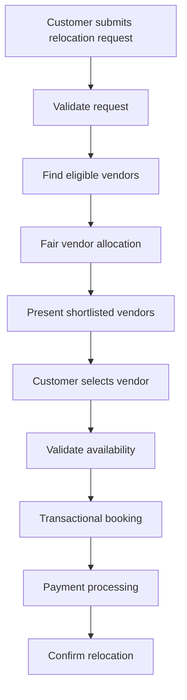

# 4mulaShift

### A Fair, Reliable & Unified Relocation Platform

4mulaShift is a relocation platform designed to simplify the moving process by connecting customers with suitable moving service providers through a structured, transparent, and reliable workflow.

The platform aims to address common problems in the relocation industry, including broker spam, unreliable vendor allocation, duplicate bookings, payment inconsistencies, and incorrect vehicle assignments.

---

## Overview

Moving to a new home or location often involves multiple vendors, uncertain availability, inconsistent pricing, and fragmented coordination. 4mulaShift aims to bring these operations into a unified system where relocation requests can be managed, vendors can be allocated fairly, and bookings and payments can be handled reliably.

The project focuses on backend engineering fundamentals such as transactional consistency, concurrency control, idempotency, service allocation, and scalable system design.

## Problem Statement

Traditional relocation workflows can suffer from:

- **Broker Spam:** Customers receive excessive calls and uncoordinated offers.
- **Unfair Vendor Allocation:** Vendors may not receive leads through a transparent process.
- **Double Booking:** Multiple customers may reserve the same vendor or time slot.
- **Payment Duplication:** Retries or repeated requests can result in duplicate payment operations.
- **Incorrect Vehicle Assignment:** The assigned vehicle may not meet the customer's relocation requirements.
- **Fragmented Coordination:** Booking, vendor selection, and payment processes are often disconnected.

## Objectives

- Build a structured relocation request and lead management system.
- Implement fair vendor allocation and controlled lead distribution.
- Prevent booking conflicts through database-level concurrency control.
- Support reliable payment operations using idempotency.
- Design a modular backend that can evolve as the platform grows.
- Maintain clear separation of business logic, persistence, and infrastructure.

## Core Features

### Relocation Management
- Create and manage relocation requests.
- Capture pickup, destination, moving date, and relocation requirements.
- Support structured lead information for vendor matching.

### Vendor Allocation
- Match relocation requests with eligible vendors.
- Provide a controlled selection of up to three suitable vendors.
- Design an allocation workflow with fairness and eligibility considerations.

### Booking Management
- Manage vendor availability and booking slots.
- Prevent conflicting reservations.
- Use transactional operations to maintain booking integrity.

### Payment Reliability
- Design idempotent payment operations.
- Protect against duplicate payment processing caused by retries.
- Maintain consistent booking and payment states.

### Vehicle Matching
- Match vehicle capacity with relocation requirements.
- Reduce incorrect vehicle allocation.
- Support vehicle suitability as part of the vendor and booking workflow.

---

## System Workflow



---

## Technology Stack

| Technology | Purpose |
|---|---|
| Java | Core application development |
| Spring Boot | Backend application framework |
| PostgreSQL | Persistent relational data storage |
| Redis | Caching and coordination capabilities |
| Docker | Containerization and environment consistency |

---

## Engineering Focus

4mulaShift is being designed around practical backend reliability and system design challenges.

- **Concurrency Control:** Protect critical booking operations from race conditions.
- **Transactional Integrity:** Maintain consistent state during booking workflows.
- **Idempotency:** Make repeated requests safe for sensitive operations such as payments.
- **Fair Allocation:** Develop a controlled vendor selection and lead distribution strategy.
- **Data Consistency:** Keep booking and payment state transitions reliable.
- **Modular Design:** Separate domain logic from infrastructure concerns.
- **Scalability:** Prepare the system for increasing requests, vendors, and operational workloads.

---

## Project Structure

The repository currently organizes its top-level resources into the following directories and files:

```text
4mulaShift/
├── docs/           # Project documentation
├── services/       # Backend services
├── postman/       # API testing resources
├── .env.example  # Environment configuration template
├── .gitignore
├── LICENSE
└── README.md
```

The internal service structure may evolve as the application architecture develops.

---

## Getting Started

### Prerequisites

Before running the project, ensure the following are available in your development environment:

- Java Development Kit (JDK)
- Maven or Gradle (depending on the service build configuration)
- PostgreSQL
- Redis
- Docker (optional, depending on deployment configuration)

### Installation

Clone the repository:

```bash
git clone https://github.com/4mulaMind-Org/4mulashift.git
cd 4mulashift
```

Configure the required environment variables using the provided `.env.example` file.

> Service-specific installation and startup instructions will be documented as the backend setup is finalized.

---

## Configuration

Application configuration is intended to be managed through environment variables rather than hardcoded credentials.

Typical configuration categories may include:

| Variable | Description |
|---|---|
| Database configuration | PostgreSQL connection settings |
| Redis configuration | Redis host, port, and connection settings |
| Application configuration | Runtime and service-specific settings |
| Payment configuration | Payment provider credentials and settings, if integrated |

Never commit real credentials, API keys, access tokens, or production secrets to the repository.

---

## API Documentation

API endpoints and request/response contracts are documented and tested through the project's API resources.

The `postman/` directory is intended to contain API testing collections and related resources.

API documentation will evolve alongside service implementation.

---

## Roadmap

- [ ] Relocation request and lead management
- [ ] Vendor onboarding and eligibility
- [ ] Vendor matching and fair allocation strategy
- [ ] Vendor shortlist workflow
- [ ] Booking availability and concurrency protection
- [ ] Payment idempotency
- [ ] Vehicle suitability matching
- [ ] API documentation and integration testing
- [ ] Containerized development environment
- [ ] Reliability and performance testing

---

## Contributing

Contributions, ideas, bug reports, and discussions are welcome as the project evolves.

If you want to contribute:

1. Fork the repository.
2. Create a feature branch.
3. Make your changes.
4. Add or update tests where applicable.
5. Submit a pull request with a clear description of your changes.

---

## License

This project is licensed under the **MIT License**. See the [LICENSE](LICENSE) file for details.

---

<p align="center">
  Built with a focus on fairness, reliability, and engineering better relocation experiences.
</p>
