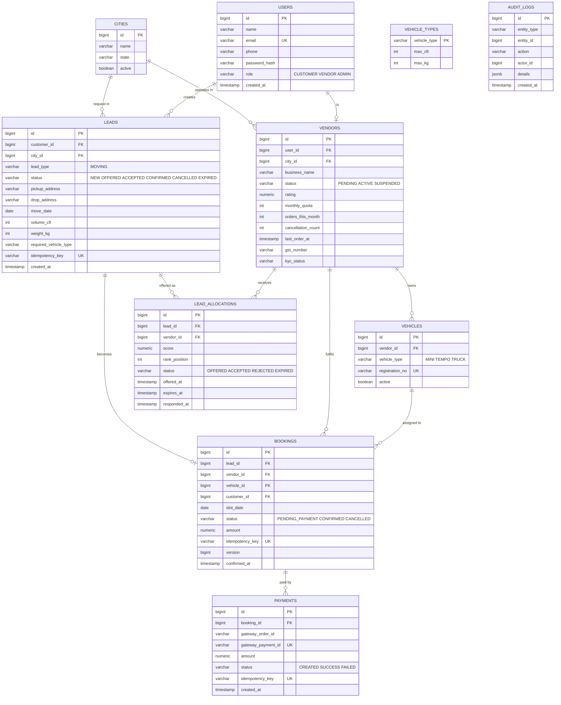

# ER Diagram and Data Model (MVP)

**Status:** Draft v0.1 | **Database:** PostgreSQL 16 | **Related:** `docs/PRD.md`, `docs/user-stories.md`

GitHub renders the diagram below automatically.



`VEHICLE_TYPES` is a small config table (the volume matrix).
`AUDIT_LOGS` is append-only and intentionally has no foreign keys, so it never blocks or breaks when business rows change.

## Key design decisions in the schema

| Decision | Why |
|---|---|
| Unique `(lead_id, vendor_id)` on `lead_allocations` | A vendor can never be offered the same lead twice. |
| Unique `lead_id` on `bookings` | One lead produces at most one booking. |
| Partial unique index on `bookings (vehicle_id, slot_date)` where status is `PENDING_PAYMENT` or `CONFIRMED` | Second line of defence for double booking. Even if the lock logic had a bug, the database refuses a second pending or confirmed booking for the same vehicle and day. |
| `idempotency_key` unique on `leads`, `bookings`, `payments` | Redis is the fast path, but the database constraint guarantees no duplicates even if Redis is flushed. |
| Unique `gateway_payment_id` on `payments` | A duplicate payment webhook cannot create a second payment row. |
| `version` column on `bookings` | Allows optimistic locking checks as an extra guard on updates. |
| Vendor counters on `vendors` (`orders_this_month`, `cancellation_count`, `last_order_at`) | The scoring formula needs them quickly. Updated inside the same transaction as the booking. |
| `lead_type` on `leads` | Lets PG, flat and marketplace leads reuse the same table later; type-specific details go into separate detail tables. |
| Money as `numeric`, never float | Avoids rounding errors in payments. |

## Locking rule (used in the booking service)

```sql
-- inside one transaction
SELECT * FROM vehicles WHERE id = :vehicleId FOR UPDATE;

-- then check no active (pending ya confirmed) booking exists for (vehicle_id, slot_date)
-- then insert the booking and update vendor counters
```

The second transaction waits on the row lock, then sees the active booking and is rejected gracefully.

## Indexes (initial)
- `vendors (city_id, status)` for eligible-vendor lookup
- `lead_allocations (lead_id)`, `lead_allocations (vendor_id, status)`
- `bookings (vehicle_id, slot_date)` (the partial unique index above)
- `leads (city_id, status)`, `leads (idempotency_key)`
- `audit_logs (entity_type, entity_id)`

## Assumptions (to confirm)
- A vehicle can take one booking per day in the MVP (`slot_date`). Time-window slots come later.
- One vendor account maps to one user and one city.
- Audit logs stay in PostgreSQL for the MVP; they can move to MongoDB in Phase 2.
- Customer phone numbers are hidden by the API layer, not by the schema.

## Flyway migration plan

| Migration | Content |
|---|---|
| `V1__create_users_cities.sql` | `cities`, `users` |
| `V2__create_vendors_vehicles.sql` | `vendors`, `vehicle_types`, `vehicles` |
| `V3__create_leads_allocations.sql` | `leads`, `lead_allocations` |
| `V4__create_bookings_payments.sql` | `bookings`, `payments`, partial unique index |
| `V5__create_audit_logs.sql` | `audit_logs` |
