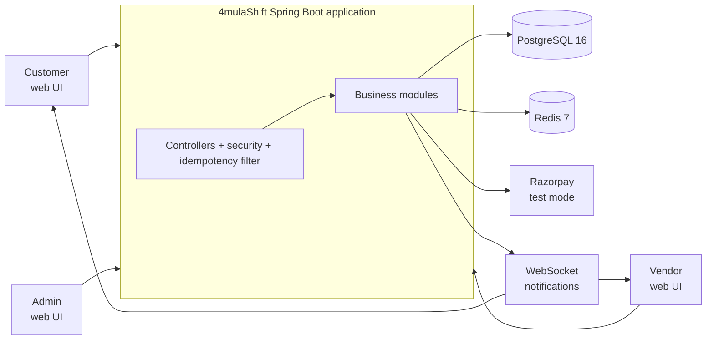
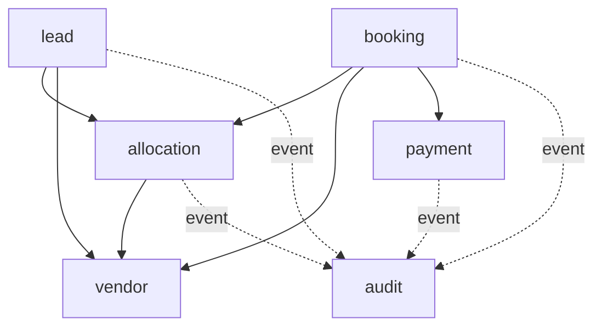
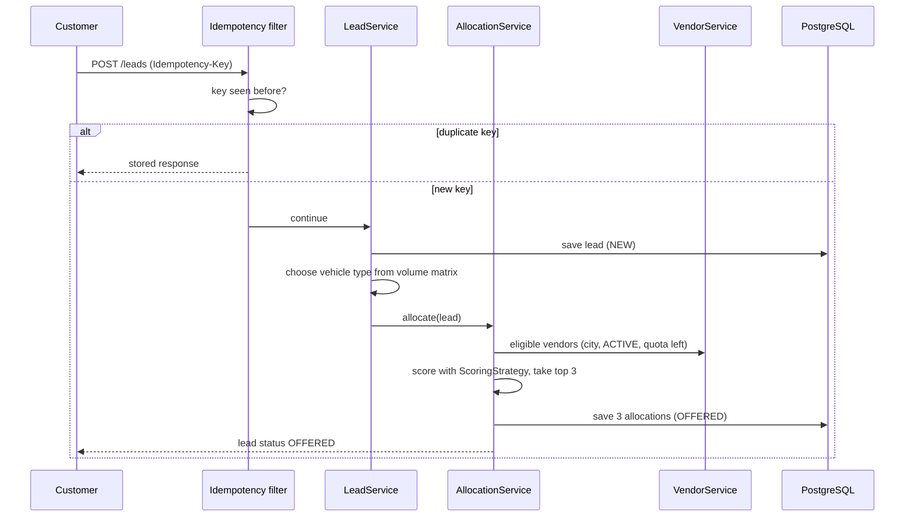
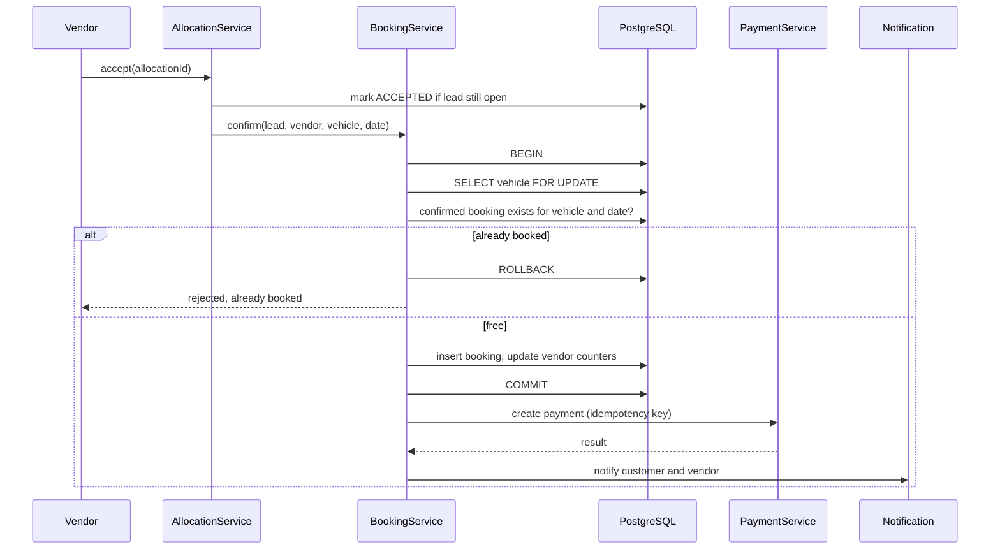
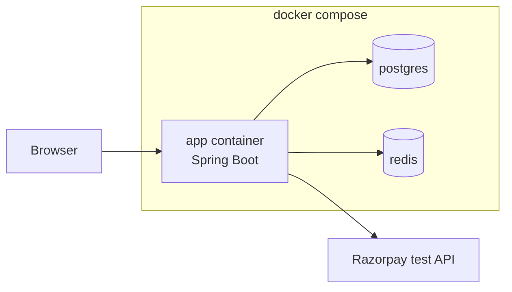

# High-Level Design (HLD): 4mulaShift MVP

**Status:** Draft v0.1 | **Related:** `docs/PRD.md`, `docs/user-stories.md`, `docs/02-design/er-diagram.md`

## 1. Architecture style

A **modular monolith**: one Spring Boot application, one deployable, split into business modules with strict boundaries. Modules can be extracted into services later if one needs independent scaling.

Why not microservices now: one developer, one team, one database transaction boundary for booking. Microservices would add network failures and distributed transactions with no benefit at this stage.

## 2. System context



## 3. Modules and responsibilities

| Module | Responsibility | Owns tables |
|---|---|---|
| `user` | Registration, login, roles, JWT | `users` |
| `vendor` | Vendor profile, KYC status, quota, rating, vehicles | `vendors`, `vehicles`, `vehicle_types` |
| `lead` | Create and track requests, vehicle matching, status flow | `leads` |
| `allocation` | Score eligible vendors, create 3 offers, handle accept, reject and expiry | `lead_allocations` |
| `booking` | Confirm booking with row lock, cancellation | `bookings` |
| `payment` | Create payment, verify webhook, idempotent updates | `payments` |
| `audit` | Append-only record of every decision | `audit_logs` |
| `common` | Config, exceptions, idempotency filter, utilities | none |

### Dependency rules



- A module never reads another module's repository or tables. It calls the other module's **service interface**.
- `audit` is fed by **application events**, so business modules do not depend on it directly.
- No circular dependencies. This is checked with ArchUnit or Spring Modulith tests.

## 4. Layers inside each module

```
controller  ->  service (interface + impl)  ->  repository  ->  entity
                  |
                  +-- dto, mapper, exception, strategy
```

- Controller: validates input, returns DTOs, contains no business logic.
- Service: business rules and `@Transactional` boundaries.
- Repository: data access only.
- Entities never leave the service layer; the API uses DTOs.

## 5. Key flow 1: request to allocation



## 6. Key flow 2: accept to confirmed booking



## 7. Cross-cutting concerns

| Concern | Approach |
|---|---|
| Idempotency | Servlet filter checks Redis (24h TTL); database unique keys are the final guard |
| Security | JWT, role-based access (CUSTOMER, VENDOR, ADMIN), rate limiting |
| Transactions | `@Transactional` in services; booking uses pessimistic lock |
| Validation | Bean Validation on DTOs, global exception handler with consistent error format |
| Audit | Application events written to `audit_logs` |
| Observability | Structured logs with correlation ID, health endpoint, error tracking |
| Config | Environment variables, secrets never committed |
| Migrations | Flyway, one migration per change |

## 8. Technology choices

| Layer | Choice | Reason |
|---|---|---|
| Language and framework | Java 21, Spring Boot 3 | Strength of the developer, mature transactions |
| Database | PostgreSQL 16 | ACID, row-level locking |
| Cache and keys | Redis 7 | Fast idempotency keys with TTL |
| Migrations | Flyway | Versioned schema in the repo |
| Tests | JUnit 5, Testcontainers | Real PostgreSQL and Redis in tests, proves locking |
| API testing | Postman | Collection stored in the repo |
| Frontend | Thymeleaf or HTML, CSS, JS | Enough for MVP; backend is the product |
| Packaging | Docker, Docker Compose | One command to run app, Postgres, Redis |
| CI | GitHub Actions | Build and test on every push |

## 9. Deployment view (MVP)



## 10. Requirement coverage

| Requirement | Where it is handled |
|---|---|
| No double booking (US-12) | `booking` module: `FOR UPDATE` plus partial unique index |
| No duplicate request or payment (US-04, US-05) | Idempotency filter plus unique keys |
| Fair allocation to 3 vendors (US-03, US-09) | `allocation` module with `ScoringStrategy` |
| Audit (US-14) | `audit` module via events |
| Roles (US-15) | Security layer, JWT |
| Real-time status (US-06) | WebSocket notifications |

## 11. Extension points (later phases)

- New lead types (PG, flat): add a `LeadType` value and a new `ScoringStrategy`; allocation, booking and payment stay unchanged.
- AI scoring: a separate Python service behind the same `ScoringStrategy` interface, with the rule-based version as fallback.
- Microservices: extract a module along its service interface; tables are already owned per module.

## 12. Architecture Decision Records to write next

- ADR-001: Pessimistic row lock in PostgreSQL for booking
- ADR-002: Modular monolith instead of microservices
- ADR-003: Idempotency in Redis plus database constraints

## 13. Open design questions

- Offer expiry: scheduled job or delayed check? (A scheduled job is the simpler MVP choice.)
- Where should the accept-window logic live if we add one?
- How is a vehicle chosen for a vendor at confirmation time: vendor selects, or the system picks the first free vehicle of the required type?